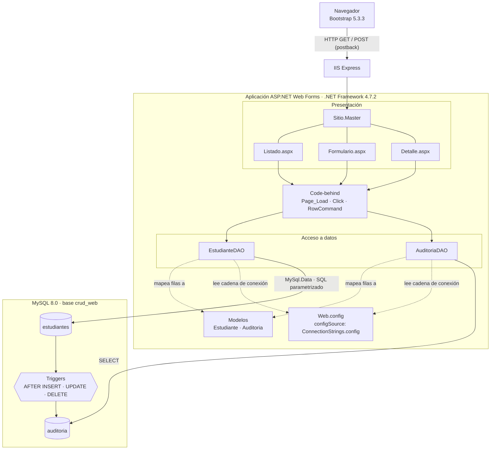
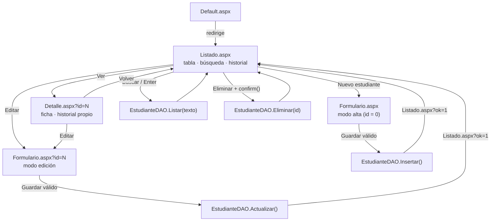
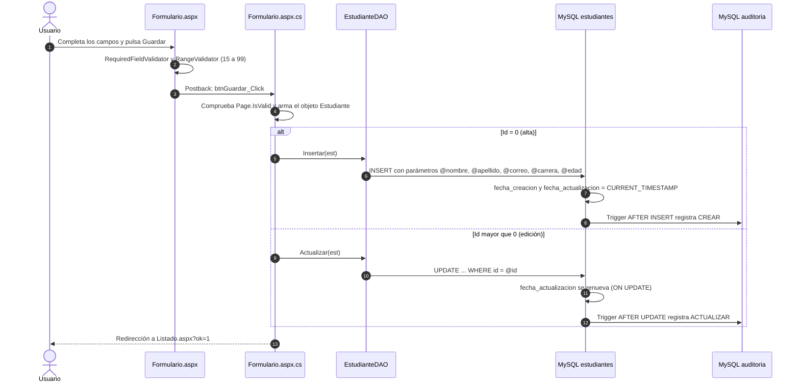
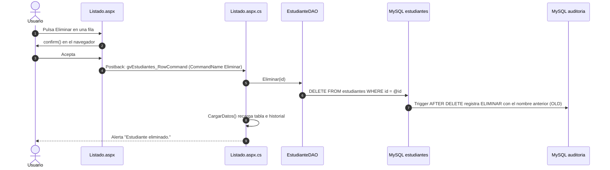
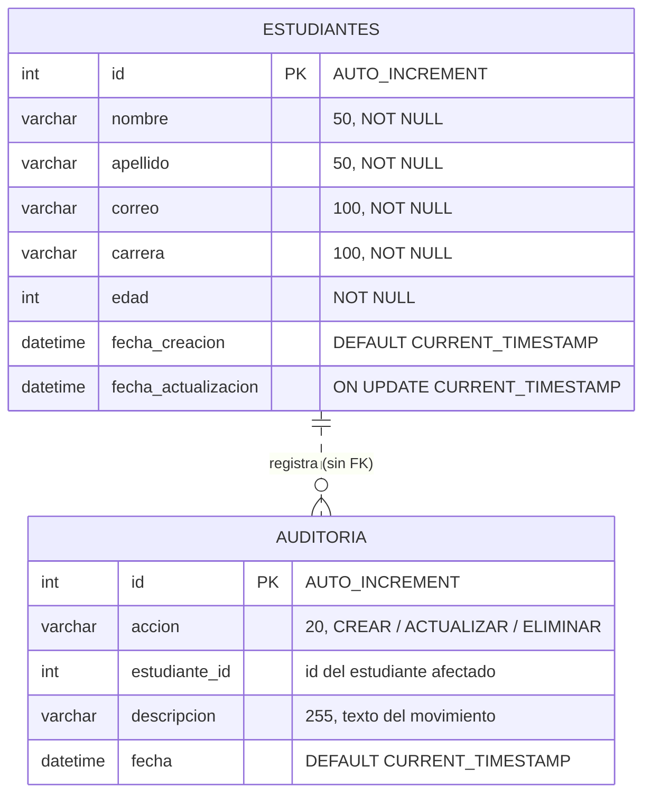
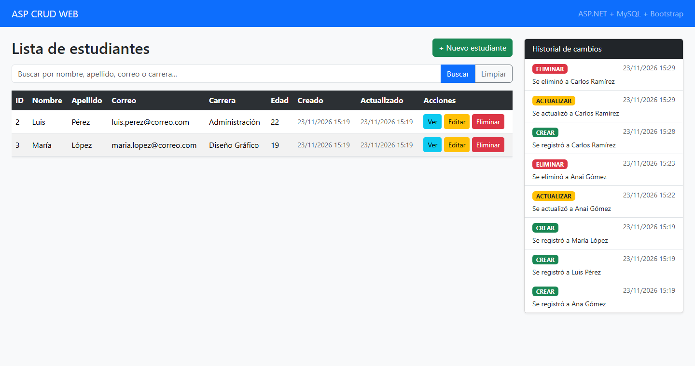
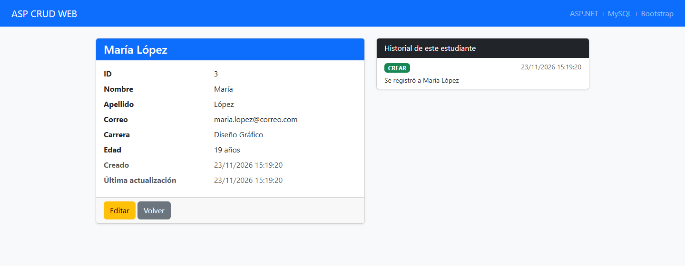
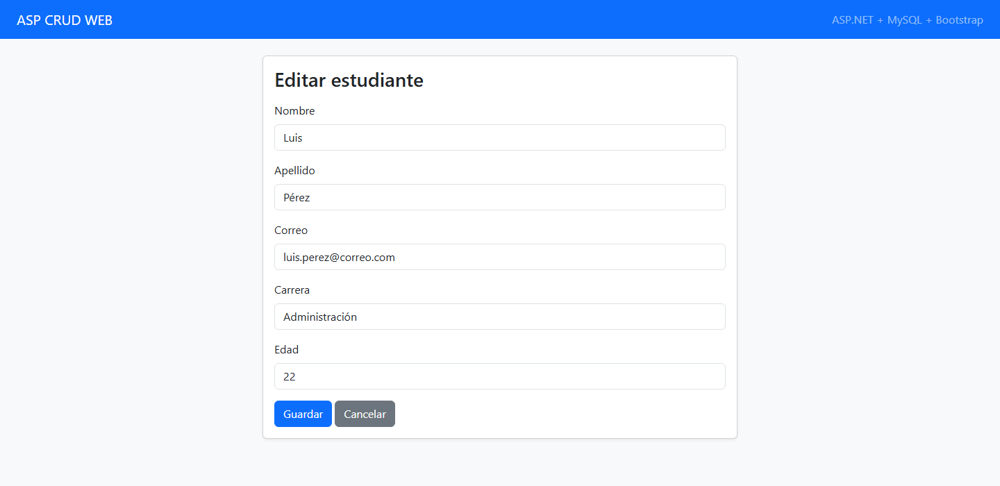

<div align="center">

# ASP CRUD WEB

### Sistema de gestión de estudiantes con auditoría automática

Aplicación web CRUD desarrollada con **ASP.NET Web Forms**, **C#** y **MySQL**, con interfaz **Bootstrap 5**,
búsqueda de registros e historial de cambios generado directamente por la base de datos mediante *triggers*.

<br>


<br>

[Descripción](#descripcion) &nbsp;·&nbsp;
[Características](#caracteristicas) &nbsp;·&nbsp;
[Arquitectura](#arquitectura) &nbsp;·&nbsp;
[Modelo de datos](#modelo-de-datos) &nbsp;·&nbsp;
[Instalación](#instalacion) &nbsp;·&nbsp;
[Operaciones CRUD](#operaciones-crud) &nbsp;·&nbsp;
[Capturas](#capturas)

</div>

---

## Contenido

| Sección | Sección |
|---|---|
| [1. Descripción del proyecto](#descripcion) | [10. Requisitos previos](#requisitos) |
| [2. Objetivo del sistema](#objetivo) | [11. Instalación y configuración](#instalacion) |
| [3. Características principales](#caracteristicas) | [12. Configuración de la base de datos](#base-de-datos) |
| [4. Tecnologías utilizadas](#tecnologias) | [13. Ejecución del proyecto](#ejecucion) |
| [5. Arquitectura del sistema](#arquitectura) | [14. Funcionamiento de las operaciones CRUD](#operaciones-crud) |
| [6. Diagrama de arquitectura](#diagrama-arquitectura) | [15. Capturas de pantalla](#capturas) |
| [7. Flujo de las operaciones CRUD](#flujo-crud) | [16. Seguridad y manejo de credenciales](#seguridad) |
| [8. Modelo de datos](#modelo-de-datos) | [17. Solución de problemas](#problemas) |
| [9. Estructura del proyecto](#estructura) | [18. Mejoras futuras](#mejoras) · [19. Autoría y créditos](#creditos) |

---

<a id="descripcion"></a>

## 1. Descripción del proyecto

**ASP CRUD WEB** es una aplicación web para administrar un registro de estudiantes. Permite crear, consultar,
buscar, editar y eliminar estudiantes desde el navegador, y conserva un historial de cada operación realizada.

El proyecto está organizado en capas (presentación, code-behind, acceso a datos y modelos) y delega la auditoría
a la propia base de datos: las fechas de creación y actualización las asigna MySQL, y cada alta, modificación o
baja queda registrada por *triggers* en una tabla de historial independiente.

<a id="objetivo"></a>

## 2. Objetivo del sistema

Ofrecer una implementación clara y funcional de las cuatro operaciones básicas de persistencia sobre una entidad
real (**estudiantes**), con:

- Separación entre interfaz, lógica de eventos y acceso a datos.
- Acceso a MySQL mediante ADO.NET (`MySql.Data`) con **consultas parametrizadas**.
- **Trazabilidad**: saber cuándo se creó, cuándo se modificó y qué operaciones se hicieron sobre cada registro.
- Configuración que mantiene las **credenciales fuera del control de versiones**.

<a id="caracteristicas"></a>

## 3. Características principales

| Módulo | Funcionalidad | Implementación |
|---|---|---|
| **Listado** | Tabla de estudiantes con fechas de creación y actualización | `GridView` en `Listado.aspx` + `EstudianteDAO.Listar()` |
| **Búsqueda** | Filtro por nombre, apellido, correo o carrera (Enter o botón *Buscar*) | `EstudianteDAO.Listar(texto)` con `LIKE @texto` |
| **Alta** | Registro de un estudiante nuevo | `Formulario.aspx` (id = 0) + `EstudianteDAO.Insertar()` |
| **Edición** | Modificación de un estudiante existente | `Formulario.aspx?id=N` + `EstudianteDAO.Actualizar()` |
| **Detalle** | Ficha completa del estudiante y su historial | `Detalle.aspx?id=N` + `EstudianteDAO.ObtenerPorId()` |
| **Eliminación** | Borrado con confirmación previa en el navegador | `LinkButton` con `confirm()` + `EstudianteDAO.Eliminar()` |
| **Validación** | Campos obligatorios y edad entre 15 y 99 | `RequiredFieldValidator` y `RangeValidator` |
| **Auditoría** | Fechas automáticas e historial de operaciones | Columnas `DEFAULT` / `ON UPDATE CURRENT_TIMESTAMP` + 3 *triggers* |
| **Historial global** | Últimos 10 movimientos junto al listado | `Repeater` + `AuditoriaDAO.Listar()` |
| **Historial por estudiante** | Últimos 10 movimientos del registro consultado | `AuditoriaDAO.Listar(estudianteId)` |
| **Mensajes** | Alertas de éxito, eliminación y error de conexión | Alertas de Bootstrap en `Listado.aspx` |

<a id="tecnologias"></a>

## 4. Tecnologías utilizadas

| Tecnología | Versión | Uso en el proyecto |
|---|---|---|
|  | .NET Framework 4.7.2 | Páginas `.aspx`, página maestra y controles de servidor |
|  | Compilador de .NET Framework | Code-behind, modelos y capa de acceso a datos |
|  | 8.0 | Base de datos `crud_web`, tablas y *triggers* |
|  | 26.7.0 (NuGet) | Conexión ADO.NET: `MySqlConnection`, `MySqlCommand` |
|  | 5.3.3 (CDN jsDelivr) | Estilos, tablas, tarjetas, formularios y alertas |
|  | DotNetCompilerPlatform 2.0.1 | Compilación de páginas en tiempo de ejecución |
|  | Incluido con Visual Studio | Servidor web de desarrollo |
|  | Solución `.slnx` | Edición, compilación y depuración |

> Bootstrap se carga desde CDN, por lo que la interfaz necesita conexión a internet para mostrar los estilos.

<a id="arquitectura"></a>

## 5. Arquitectura del sistema

La aplicación sigue una arquitectura en capas dentro de un único proyecto web:

| Capa | Ubicación | Responsabilidad |
|---|---|---|
| **Presentación** | `Paginas/*.aspx`, `Paginas/Sitio.Master` | Marcado HTML, controles de servidor y estilos Bootstrap |
| **Code-behind** | `Paginas/*.aspx.cs` | Manejo de eventos (`Page_Load`, `Click`, `RowCommand`) y enlace de datos |
| **Acceso a datos** | `Datos/EstudianteDAO.cs`, `Datos/AuditoriaDAO.cs` | Única capa que se comunica con MySQL, siempre con parámetros |
| **Modelos** | `Modelos/Estudiante.cs`, `Modelos/Auditoria.cs` | Objetos que representan las filas de cada tabla |
| **Configuración** | `Web.config` → `ConnectionStrings.config` | Cadena de conexión externa, no versionada |
| **Base de datos** | `BaseDeDatos/crud_web.sql` | Esquema, valores automáticos de fecha y *triggers* de auditoría |

Cada página crea su propia instancia del DAO; cada método abre la conexión dentro de un bloque `using`, ejecuta una
única sentencia y la cierra al terminar.

<a id="diagrama-arquitectura"></a>

## 6. Diagrama de arquitectura



<a id="flujo-crud"></a>

## 7. Flujo de las operaciones CRUD

### Navegación entre páginas



### Guardado (alta o edición) y registro de auditoría



### Eliminación



<a id="modelo-de-datos"></a>

## 8. Modelo de datos

La base `crud_web` contiene dos tablas. `auditoria.estudiante_id` guarda el identificador del estudiante
**sin clave foránea**, de forma intencional: así el historial se conserva aunque el estudiante se elimine.



### Tabla `estudiantes`

| Columna | Tipo | Restricciones | Propiedad en `Estudiante` |
|---|---|---|---|
| `id` | `INT` | `PRIMARY KEY`, `AUTO_INCREMENT` | `Id` |
| `nombre` | `VARCHAR(50)` | `NOT NULL` | `Nombre` |
| `apellido` | `VARCHAR(50)` | `NOT NULL` | `Apellido` |
| `correo` | `VARCHAR(100)` | `NOT NULL` | `Correo` |
| `carrera` | `VARCHAR(100)` | `NOT NULL` | `Carrera` |
| `edad` | `INT` | `NOT NULL` | `Edad` |
| `fecha_creacion` | `DATETIME` | `DEFAULT CURRENT_TIMESTAMP` | `FechaCreacion` |
| `fecha_actualizacion` | `DATETIME` | `DEFAULT CURRENT_TIMESTAMP ON UPDATE CURRENT_TIMESTAMP` | `FechaActualizacion` |

### Tabla `auditoria`

| Columna | Tipo | Descripción | Propiedad en `Auditoria` |
|---|---|---|---|
| `id` | `INT` | Clave primaria autoincremental | `Id` |
| `accion` | `VARCHAR(20)` | `CREAR`, `ACTUALIZAR` o `ELIMINAR` | `Accion` |
| `estudiante_id` | `INT` | Estudiante afectado | `EstudianteId` |
| `descripcion` | `VARCHAR(255)` | Texto generado por el *trigger* | `Descripcion` |
| `fecha` | `DATETIME` | Momento de la operación | `Fecha` |

La propiedad calculada `Auditoria.Color` asigna el color de la etiqueta en la interfaz: verde (`CREAR`),
amarillo (`ACTUALIZAR`) o rojo (`ELIMINAR`).

### Triggers

| Trigger | Evento | Acción registrada |
|---|---|---|
| `trg_estudiantes_crear` | `AFTER INSERT` | `CREAR` — "Se registró a *nombre apellido*" |
| `trg_estudiantes_actualizar` | `AFTER UPDATE` | `ACTUALIZAR` — "Se actualizó a *nombre apellido*" |
| `trg_estudiantes_eliminar` | `AFTER DELETE` | `ELIMINAR` — "Se eliminó a *nombre apellido*" |

<a id="estructura"></a>

## 9. Estructura del proyecto

```text
ASP CRUD WEB/
├── ASP CRUD WEB/                          Proyecto web (ASP.NET Web Forms)
│   ├── Datos/
│   │   ├── EstudianteDAO.cs               Listar, buscar, obtener, insertar, actualizar, eliminar
│   │   └── AuditoriaDAO.cs                Lectura del historial de auditoría
│   ├── Modelos/
│   │   ├── Estudiante.cs                  Entidad de la tabla estudiantes
│   │   └── Auditoria.cs                   Entidad de la tabla auditoria
│   ├── Paginas/
│   │   ├── Sitio.Master                   Plantilla común: Bootstrap y barra de navegación
│   │   ├── Listado.aspx                   Tabla, búsqueda, eliminación e historial global
│   │   ├── Formulario.aspx                Alta y edición con validadores
│   │   └── Detalle.aspx                   Ficha del estudiante e historial propio
│   ├── Properties/
│   │   └── AssemblyInfo.cs
│   ├── ASP CRUD WEB.csproj                Proyecto y paquetes NuGet
│   ├── ConnectionStrings.example.config   Plantilla de conexión (sí se versiona)
│   ├── Default.aspx                       Redirige a Paginas/Listado.aspx
│   └── Web.config                         Configuración de la aplicación
├── BaseDeDatos/
│   └── crud_web.sql                       Esquema, triggers y datos de ejemplo
├── docs/
│   ├── assets/                            Recursos gráficos del proyecto
│   └── screenshots/                       Capturas de la aplicación
├── .gitattributes                         Normalización de saltos de línea
├── .gitignore                             Exclusiones, incluidas las credenciales
├── ASP CRUD WEB.slnx                      Solución de Visual Studio
└── README.md
```

Cada página `.aspx` se acompaña de su code-behind (`.aspx.cs`) y del archivo de declaraciones generado por
Visual Studio (`.aspx.designer.cs`). El archivo local `ConnectionStrings.config` existe solo en cada equipo y
está excluido por `.gitignore`.

<a id="requisitos"></a>

## 10. Requisitos previos

| Requisito | Detalle |
|---|---|
| **Sistema operativo** | Windows (IIS Express y .NET Framework 4.7.2) |
| **Visual Studio** | Con la carga de trabajo *Desarrollo de ASP.NET y web* y soporte para soluciones `.slnx` |
| **.NET Framework** | 4.7.2 Developer Pack (incluido con la carga de trabajo anterior) |
| **MySQL Server** | 8.0, con el servicio `MySQL80` en ejecución en `localhost:3306` |
| **Cliente SQL** | MySQL Workbench o la consola `mysql` |
| **Internet** | Para restaurar paquetes NuGet y cargar Bootstrap desde CDN |

<a id="instalacion"></a>

## 11. Instalación y configuración

**1. Clonar el repositorio**

```powershell
git clone <url-del-repositorio>
cd "ASP CRUD WEB"
```

**2. Crear el archivo de conexión local** a partir de la plantilla versionada:

```powershell
Copy-Item "ASP CRUD WEB\ConnectionStrings.example.config" "ASP CRUD WEB\ConnectionStrings.config"
```

**3. Editar `ASP CRUD WEB\ConnectionStrings.config`** y reemplazar el valor de ejemplo por tus datos de MySQL:

```xml
<connectionStrings>
  <add name="conexion"
       connectionString="Server=localhost;Port=3306;Database=crud_web;Uid=root;Pwd=TU_PASSWORD;"
       providerName="MySql.Data.MySqlClient" />
</connectionStrings>
```

> `ConnectionStrings.config` está en `.gitignore`. Nunca copies tu contraseña real en `Web.config`,
> en la plantilla `.example.config` ni en este README.

`Web.config` no contiene credenciales: solo referencia el archivo externo.

```xml
<connectionStrings configSource="ConnectionStrings.config" />
```

<a id="base-de-datos"></a>

## 12. Configuración de la base de datos

El script [`BaseDeDatos/crud_web.sql`](BaseDeDatos/crud_web.sql) realiza, en orden:

1. Crea la base `crud_web` (`utf8mb4`) si no existe.
2. Elimina las tablas `auditoria` y `estudiantes` si ya existían.
3. Crea la tabla `estudiantes` con sus columnas de fecha automáticas.
4. Crea la tabla `auditoria`.
5. Crea los tres *triggers* de auditoría.
6. Inserta tres estudiantes de ejemplo, que quedan registrados en el historial.

**Desde MySQL Workbench:** abrir el archivo y ejecutarlo completo.

**Desde la consola:**

```powershell
Get-Content "BaseDeDatos\crud_web.sql" -Encoding UTF8 | mysql -u root -p
```

> El script elimina y vuelve a crear las tablas: ejecutarlo de nuevo borra los datos existentes.

<a id="ejecucion"></a>

## 13. Ejecución del proyecto

### Desde Visual Studio

1. Abrir `ASP CRUD WEB.slnx`.
2. Pulsar **F5**. En la primera compilación se restauran los paquetes NuGet (`MySql.Data` y `DotNetCompilerPlatform`).
3. La aplicación se abre en IIS Express; `Default.aspx` redirige a `Paginas/Listado.aspx`.

### Desde la línea de comandos

```powershell
# Compilar (restaura paquetes NuGet)
& "C:\Program Files\Microsoft Visual Studio\18\Community\MSBuild\Current\Bin\MSBuild.exe" `
    "ASP CRUD WEB\ASP CRUD WEB.csproj" -restore

# Servir la carpeta del proyecto con IIS Express
& "C:\Program Files\IIS Express\iisexpress.exe" /path:"$PWD\ASP CRUD WEB" /port:8080
```

Luego abrir `http://localhost:8080`. La ruta de `MSBuild.exe` depende de la edición de Visual Studio instalada.

<a id="operaciones-crud"></a>

## 14. Funcionamiento de las operaciones CRUD

| Operación | Acción del usuario | Página | Método DAO | SQL | Auditoría |
|---|---|---|---|---|---|
| **Create** | *+ Nuevo estudiante* → completar → *Guardar* | `Formulario.aspx` | `Insertar(est)` | `INSERT INTO estudiantes ...` | `CREAR` |
| **Read** (lista) | Abrir la aplicación | `Listado.aspx` | `Listar()` | `SELECT * ... ORDER BY id` | — |
| **Read** (búsqueda) | Escribir texto → Enter o *Buscar* | `Listado.aspx` | `Listar(texto)` | `... WHERE nombre LIKE @texto OR ...` | — |
| **Read** (detalle) | *Ver* en una fila | `Detalle.aspx?id=N` | `ObtenerPorId(id)` | `SELECT * ... WHERE id = @id` | — |
| **Update** | *Editar* → modificar → *Guardar* | `Formulario.aspx?id=N` | `Actualizar(est)` | `UPDATE estudiantes SET ... WHERE id = @id` | `ACTUALIZAR` |
| **Delete** | *Eliminar* → confirmar | `Listado.aspx` | `Eliminar(id)` | `DELETE FROM estudiantes WHERE id = @id` | `ELIMINAR` |

**Detalles de implementación**

- **Alta y edición comparten formulario.** `Formulario.aspx` guarda el identificador en un `HiddenField`:
  `0` ejecuta `Insertar`; cualquier otro valor ejecuta `Actualizar`.
- **Búsqueda.** El mismo método `Listar` recibe un texto opcional y lo envuelve en `%texto%`. Con texto vacío
  devuelve todos los registros. *Limpiar* vacía el campo y recarga la tabla.
- **Validación.** Los cinco campos son obligatorios y la edad debe ser un entero entre 15 y 99. El servidor
  vuelve a comprobar `Page.IsValid` antes de guardar.
- **Historial.** `Listado.aspx` muestra los 10 movimientos más recientes de todos los estudiantes;
  `Detalle.aspx` muestra los 10 más recientes del estudiante consultado.
- **Salida segura.** `GridView` codifica el HTML por defecto, `Detalle.aspx` usa `Literal` con `Mode="Encode"`
  y el historial usa la sintaxis de enlace codificada `<%#: %>`.

<a id="capturas"></a>

## 15. Capturas de pantalla

**Listado con búsqueda e historial de cambios**



**Detalle del estudiante con su historial**



**Formulario de edición**



<a id="seguridad"></a>

## 16. Seguridad y manejo de credenciales

| Aspecto | Estado |
|---|---|
| Cadena de conexión | En `ASP CRUD WEB/ConnectionStrings.config`, cargado por `configSource` desde `Web.config` |
| Exclusión del repositorio | `ConnectionStrings.config` figura en `.gitignore`; se versiona solo la plantilla `.example.config` |
| Inyección SQL | Todas las consultas usan parámetros (`@id`, `@texto`, `@nombre`, ...); no se concatena texto del usuario |
| Salida HTML | Los datos mostrados se codifican (`GridView`, `Mode="Encode"`, `<%#: %>`) |
| Acceso web a `.config` | IIS bloquea por defecto la descarga de archivos `.config` |

**Recomendaciones para entornos distintos del desarrollo local**

- Usar un usuario de MySQL dedicado con permisos solo sobre `crud_web`, en lugar de `root`.
- Establecer `compilation debug="false"` en `Web.config`.
- Mostrar un mensaje genérico ante errores de conexión y registrar el detalle en un log, en lugar de mostrar
  el texto de la excepción al usuario.

<a id="problemas"></a>

## 17. Solución de problemas

| Mensaje | Causa | Solución |
|---|---|---|
| `Access denied for user 'root'@'localhost'` | Contraseña incorrecta | Revisar `ConnectionStrings.config` |
| `No se puede leer el archivo de configuración ConnectionStrings.config` | Falta el archivo local | Crearlo desde la plantilla ([paso 2](#instalacion)) |
| `Unknown database 'crud_web'` | La base no existe | Ejecutar `BaseDeDatos/crud_web.sql` |
| `Could not find specified column in results: fecha_creacion` | Esquema anterior sin auditoría | Ejecutar de nuevo el script SQL |
| `Unable to connect to any of the specified MySQL hosts` | Servicio MySQL detenido | Iniciar el servicio `MySQL80` en *Servicios de Windows* |
| La página se ve sin estilos | Sin acceso al CDN de Bootstrap | Verificar la conexión a internet |

<a id="mejoras"></a>

## 18. Mejoras futuras

- [ ] Paginación y ordenamiento por columna en el listado.
- [ ] Validación de formato y unicidad del correo electrónico.
- [ ] Guardar en la auditoría los valores anteriores (`OLD`) y no solo los nuevos.
- [ ] Autenticación de usuarios y registro de quién realizó cada cambio.
- [ ] Usuario de MySQL con privilegios mínimos para la aplicación.
- [ ] Manejo centralizado de errores y registro en log, sin exponer mensajes internos.
- [ ] Cadena de conexión desde variables de entorno mediante *Configuration Builders* para despliegues.
- [ ] Pruebas automatizadas de la capa de acceso a datos.
- [ ] Servir Bootstrap localmente para funcionar sin conexión.
- [ ] Migración a ASP.NET Core con Entity Framework Core.

<a id="creditos"></a>

## 19. Autoría y créditos

| Rol | Nombre |
|---|---|
| **Autor** | *Agrega aquí tu nombre y tu perfil de GitHub* |

**Recursos de terceros**

- [Bootstrap](https://getbootstrap.com/) — framework CSS (licencia MIT).
- [MySQL Connector/NET](https://dev.mysql.com/downloads/connector/net/) — paquete NuGet `MySql.Data`.
- [Shields.io](https://shields.io/) — badges de este documento.
- [Mermaid](https://mermaid.js.org/) — diagramas renderizados por GitHub.

---

<div align="center">

**ASP CRUD WEB** · ASP.NET Web Forms · C# · MySQL · Bootstrap

</div>
